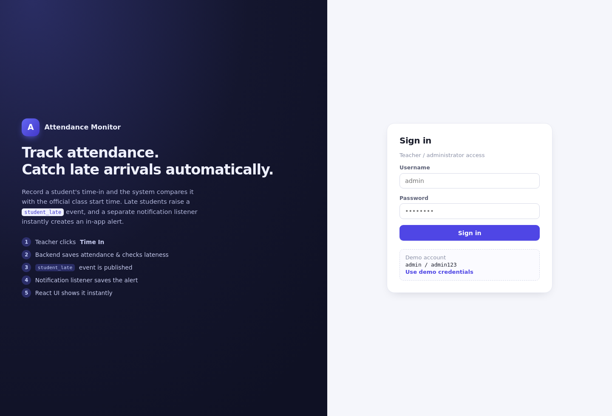
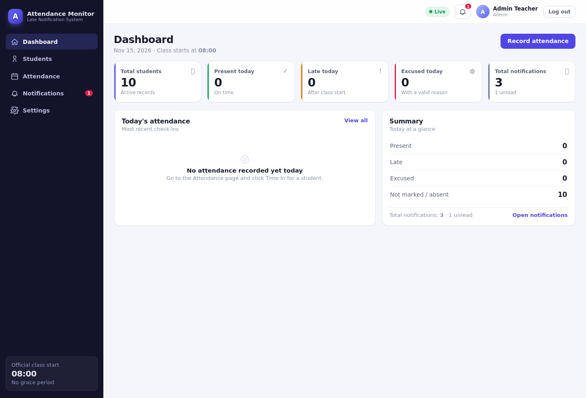
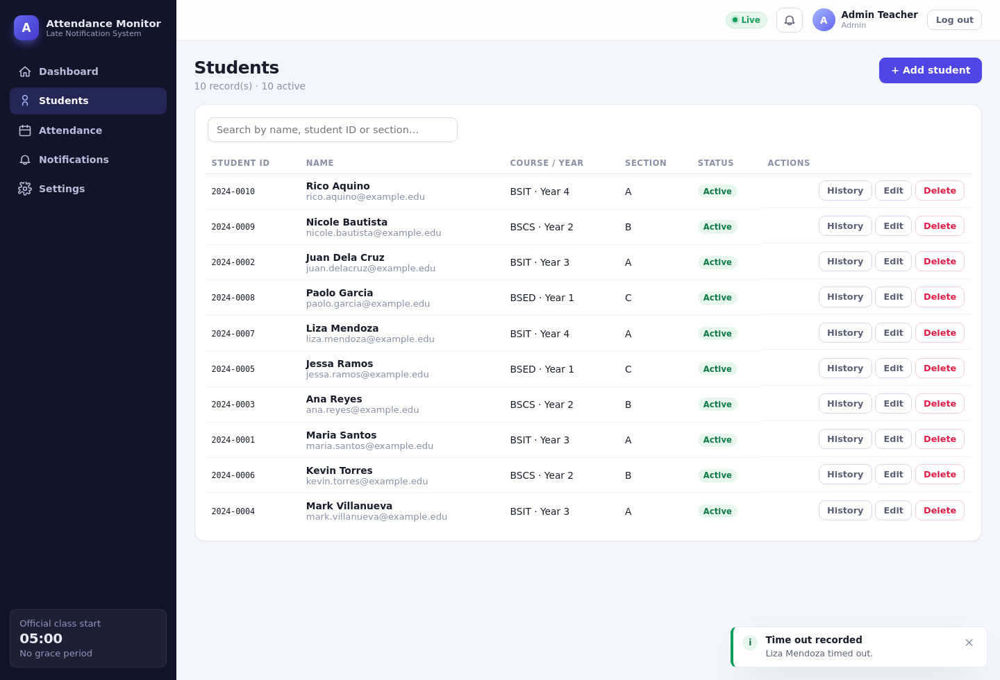
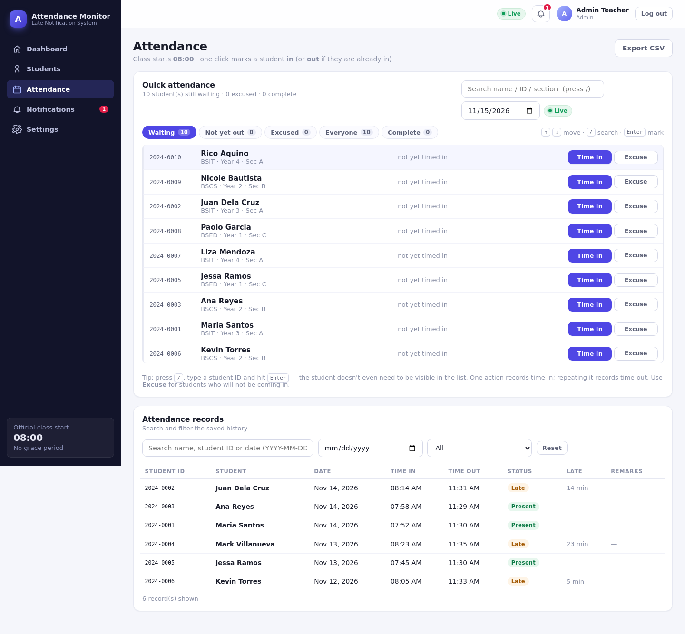
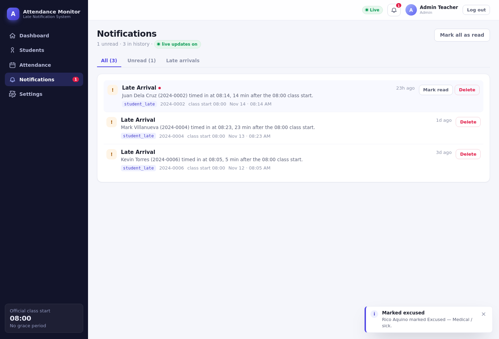
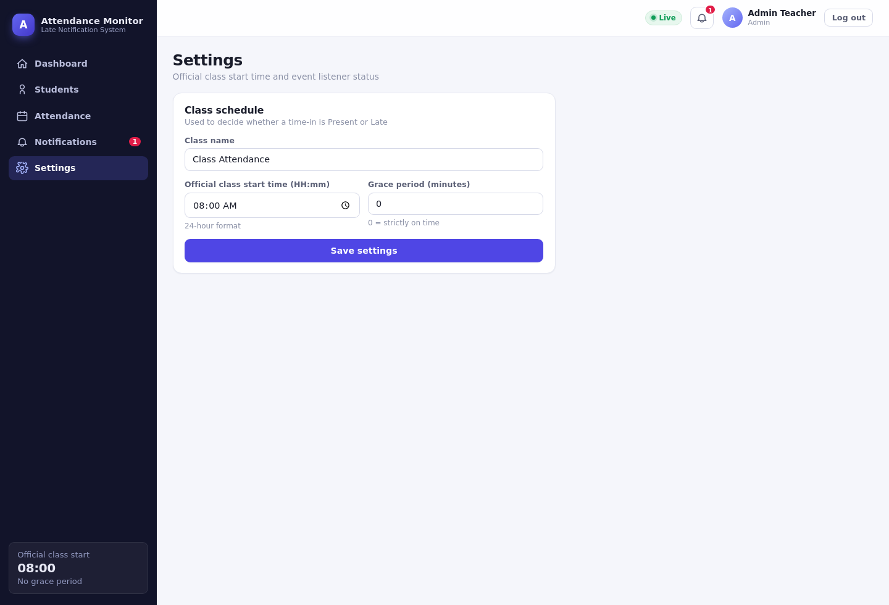
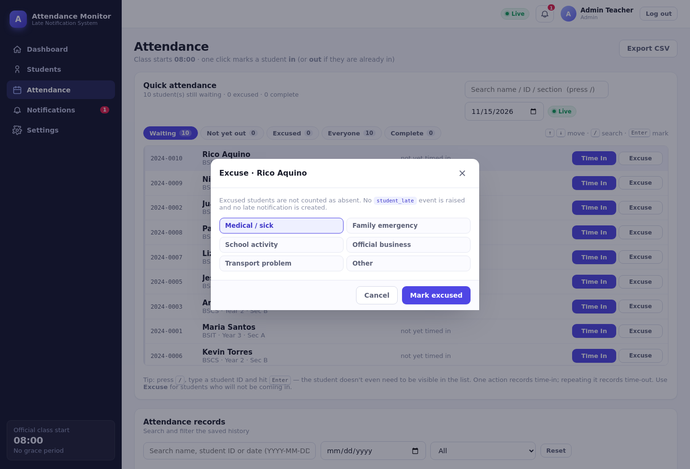
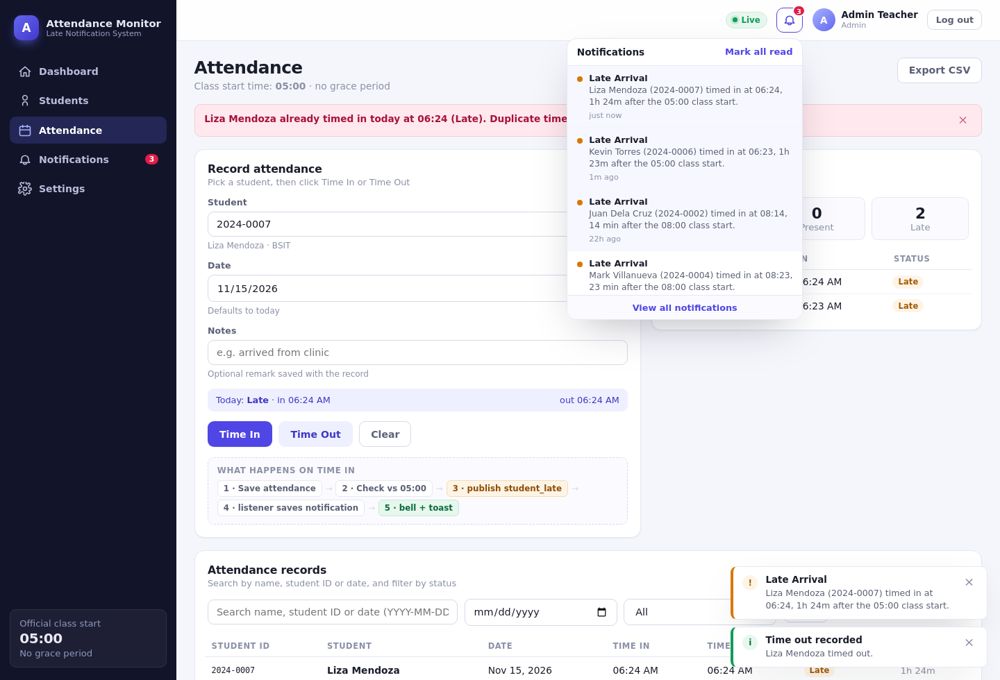
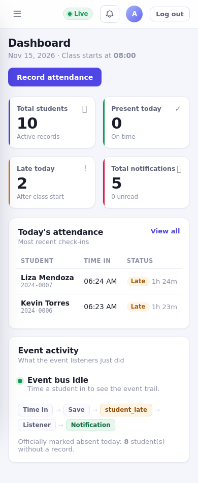

# Student Attendance Monitoring System
### with Automatic Late Notification (event-driven)

A small, complete full-stack project for a one-week school requirement.

- **Frontend:** React 18 + Vite 6 + React Router 6 + Socket.IO client (plain CSS, no UI framework)
- **Backend:** Node.js + Express + Mongoose (MongoDB) + Socket.IO
- **Database:** MongoDB — either your own MongoDB (`MONGODB_URI`) or the built-in **in-memory MongoDB** that starts automatically for demos

---

## 1. What it does

| Feature | Where |
| --- | --- |
| Admin / teacher login (JWT) | `client/src/pages/LoginPage.jsx`, `server/src/routes/auth.routes.js` |
| Add / view / edit / delete students | `client/src/pages/StudentsPage.jsx`, `students.routes.js` |
| Record time-in and time-out — **one click per student** | `client/src/pages/AttendancePage.jsx`, `attendance.routes.js` |
| Instant roster grid (who's still waiting) + keyboard marking | `GET /api/attendance/roster`, `POST /api/attendance/mark` |
| **Excuse a student** with a reason (not counted absent, no late event) | `POST /api/attendance/excuse`, `DELETE /api/attendance/excuse` |
| Set the official class start time (optional grace period) | `client/src/pages/SettingsPage.jsx`, `settings.routes.js` |
| Automatic **Present / Late** detection | `server/src/services/attendanceService.js` + `timeService.js` |
| Publish the `student_late` event | `server/src/events/bus.js` |
| Notification listener saves the in-app notification | `server/src/events/listeners/notificationListener.js` |
| Live notification bell + popup toasts | `client/src/components/Layout.jsx`, `context/AppDataContext.jsx` |
| Notification history, mark read / mark all read / delete | `client/src/pages/NotificationsPage.jsx` |
| Dashboard: total students, present, late, excused, total notifications | `client/src/pages/DashboardPage.jsx` |
| Search + filter attendance by name / student ID / date / status | Attendance page + `listRecords()` |
| Validation: duplicate time-in, missing student, invalid/future date, time-out without time-in | `attendanceService.js` (returns readable 400 messages) |

---

## 2. Taking attendance without the busywork

Recording a whole class should not be three steps per student. The attendance page is built
around a **roster grid**: the API returns every active student together with their state for the
day (`waiting`, `timed-in`, `complete`), so the teacher never has to search for a name.

**One action, one click.** `POST /api/attendance/mark` decides what to do from the record itself:

| Student's state for that date | What the click does |
| --- | --- |
| No record yet | Creates the **time-in** (Present or Late) — publishes `student_late` if late |
| Timed in, no time-out | Fills the **time-out** |
| Already complete | Returns a clear "attendance for today is complete" message |

The button label follows the state (`Time In` → `Time Out` → `Complete`), so there is no
dropdown and no second decision. Keyboard-only flow for a fast class:

```
press /  →  type student ID  →  press Enter      (repeat for the next student)
```

`Enter` marks whatever ID was typed — the student does not even need to be visible in the
current filter, so re-marking someone never silently fails. `↑ / ↓` move the highlight and
`Enter` on an empty box marks the highlighted row. After each save the box clears and keeps
focus, so a class of 40 is 40 ID + Enter pairs, no mouse.

Tabs (`Waiting` / `Not yet out` / `Everyone` / `Complete`) with live counts answer the question
that actually matters during roll call: **who is still missing?**

**Excuse** sits next to the mark button and covers the students who will not be coming in at
all. A quick reason picker (Medical / Family emergency / School activity / Official business /
Transport problem / Other) marks the day as **Excused**:

- no time-in is required, and the student is **not counted absent**;
- no `student_late` event and no late notification are created — they were never late;
- the excuse can be edited or removed later; removing it deletes an excuse-only record, or
  restores the real `Late`/`Present` status if the student had actually timed in first;
- an excused student is blocked from time-in until the excuse is removed, so the two states
  can never contradict each other.

The original endpoints (`/time-in`, `/time-out`, `/attendance`) are all still there — the old
two-button flow is just no longer the default. Nothing about the event-driven behaviour changed:
`student_late` still fires exactly once, on the time-in step only.

## 3. The event-driven flow (the graded part)

```
Teacher clicks Time In
        │
        ▼
POST /api/attendance/time-in
        │
        ▼
attendanceService.timeIn()
   1. validates (student exists, no duplicate, date is real & not future)
   2. saves the Attendance document (status = Present | Late)
   3. compares time-in with classStartTime (+ grace)
        │
        ▼  only when late
   bus.publish('student_late', payload)          ← publisher
        │
        ├──► notificationListener  → Notification.create()  → bus.publish('notification_created')
        │                                                        │
        │                                                        └──► realtimeListener → Socket.IO `notification:new`
        │                                                                                    │
        │                                                                                    ▼
        │                                                                          React bell badge + toast
        └──► auditListener         → console log (for the demo)
```

Key point: **`attendanceService` never creates notifications.** It only publishes an event.
The notification logic lives in a separate subscriber, so you can add other reactions
(e.g. an SMS listener later) without touching the attendance code.

Files:

| File | Role |
| --- | --- |
| `server/src/events/bus.js` | Tiny `on / off / once / publish` event bus + `EVENTS` constants |
| `server/src/events/index.js` | Registers all listeners once at startup |
| `server/src/events/listeners/notificationListener.js` | **Subscriber** — `student_late` → save notification |
| `server/src/events/listeners/realtimeListener.js` | **Subscriber** — pushes events to the browser |
| `server/src/events/listeners/demoListener.js` | **Subscriber** — logs every event to the console |
| `server/src/services/attendanceService.js` | **Publisher** — attendance rules only |

You can inspect the live wiring any time at `GET /api/settings/event-status`
(the Settings page shows it too).

---

## 4. Run it

Requirements: **Node.js 18+**. MongoDB is optional (see below).

### Quickest way — one command for both servers

From the project root (`attendance-system/`):

```bash
npm run install:all      # installs server + client dependencies
npm run dev              # starts API (:5000) and web app (:5173) together
```

Open <http://localhost:5173> and log in:

```
username: admin
password: admin123
```

10 demo students and a few past attendance records are seeded automatically.

`npm run dev` uses a small built-in script (`scripts/dev.js`) that needs **no extra
dependency** — no globally installed `concurrently`. Stop both servers with `Ctrl+C`.
Prefer separate terminals? Run `npm run server` and `npm run client` in two windows,
or `cd server && npm start` / `cd client && npm run dev`.

> On Windows, use `npm.cmd`-friendly commands — `npm run dev` already handles this.

### Troubleshooting

| Symptom | Fix |
| --- | --- |
| `'concurrently' is not recognized` | You are on an older copy of the project. This version's `npm run dev` needs no extra package — reinstall with `npm run install:all`, or just run `cd server && npm start` and `cd client && npm run dev` in two terminals. |
| `Port 5173 is already in use` | Another dev server is running. Stop it, or start with `npm run client -- --port 5174`. |
| `Cannot reach the server` on the login page | The API isn't running. Start it with `npm run server` (port 5000) and try again. |
| First API start is slow / needs internet | Demo mode downloads a MongoDB binary once (`~/.cache/mongodb-binaries`). Set `MONGODB_URI` in `server/.env` to use your own database instead. |
| Attendance says "already timed in today" | One record per student per day is enforced on purpose. Use a different student or a date. |
| `npm audit` reports 2 moderate issues | Both are in React Router 6 (SSR-only paths this app never uses). Fixing them requires React Router 7, which is a breaking upgrade — safe to ignore for this project. |

### Using your own MongoDB (recommended for a real submission)

Create `server/.env`:

```env
PORT=5000
MONGODB_URI=mongodb://127.0.0.1:27017/attendance
JWT_SECRET=replace-with-a-long-random-string
ADMIN_USERNAME=admin
ADMIN_PASSWORD=admin123
DEFAULT_CLASS_START_TIME=08:00
DEFAULT_LATE_GRACE_MINUTES=0
```

If `MONGODB_URI` is **not** set, the server boots an in-memory MongoDB automatically.
That is perfect for a demo/defense, but **data resets every restart**.

Seeding on an existing database:

```bash
cd server && npm run seed
```

---

## 5. Testing

```bash
cd server && npm test
```

29 tests covering: late detection rules, grace period, auth, student CRUD, Present vs Late
time-in, the `student_late` → notification chain, duplicate time-in, time-out without time-in,
invalid/future dates, search/filter, dashboard totals, read/delete notifications, the
one-action `mark` (time-in → time-out → complete), the roster endpoint and its counts, that a
late time-in still raises exactly one event, and the excuse flow (reason required, no late
event, blocked time-in while excused, status restored on removal, counts and filtering). The suite spins up its own in-memory MongoDB.

---

## 6. Demo script (for your presentation)

1. Log in as `admin / admin123`.
2. **Settings** → confirm the class start time (e.g. `08:00`).
3. **Attendance** → the roster grid opens on the **Waiting** tab.
   - Click **Time In** on any student. Before 08:00 → **Present**, no notification.
   - After 08:00 → **Late** → watch the toast appear and the bell badge increment.
   - The same student's button now reads **Time Out**; click it to close their record (button
     becomes **Complete** and disables).
4. Try the keyboard way: press `/`, type `2024-0003`, press `Enter`. Repeat for the next IDs —
   it never leaves the keyboard.
5. Click **Excuse** on a student who is absent, pick a reason → they move to the **Excused**
   tab, are not counted absent, and no late notification appears. Open the excuse again and
   **Remove excuse** to put them back.
6. Open **Notifications** → the new "Late Arrival" entry is in the history, unread.
   Click **Mark read** / **Mark all as read**.
7. Click / Enter a third time for a finished student → *attendance for today is complete*
   (validation, not a crash).
8. **Dashboard** → totals update live (present / late / excused / total notifications).

**Demonstrating it outside class hours:** start the backend with a time shift instead of
editing the clock:

```bash
APP_TIME_OFFSET_MINUTES=120 npm start      # server pretends it is 2 hours later
```

Or simply set the class start time in **Settings** to a time in the past — a time-in right
now is then immediately Late. (Remember to change it back.)

---

## 7. API reference

All routes except `/api/auth/login` and `/api/health` require
`Authorization: Bearer <token>`.

| Method | Route | Purpose |
| --- | --- | --- |
| POST | `/api/auth/login` | `{ username, password }` → `{ token, user }` |
| GET | `/api/auth/me` | Current user |
| GET | `/api/students?search=&active=` | List / search students |
| GET | `/api/students/:id` | One student + last 30 attendance records |
| POST | `/api/students` | Create |
| PUT | `/api/students/:id` | Update |
| DELETE | `/api/students/:id` | Delete (+ their attendance) |
| GET | `/api/attendance?search=&date=&status=&from=&to=` | Search / filter records |
| GET | `/api/attendance/roster?date=` | Every active student + their state for the day |
| POST | `/api/attendance/mark` | `{ studentId, date?, notes? }` — one action: time-in, else time-out |
| POST | `/api/attendance/excuse` | `{ studentId, date?, reason }` — mark Excused |
| DELETE | `/api/attendance/excuse?studentId=&date=` | Remove an excuse |
| POST | `/api/attendance/time-in` | `{ studentId, date?, notes? }` (explicit, still supported) |
| POST | `/api/attendance/time-out` | `{ studentId, date? }` |
| GET | `/api/attendance/dashboard?date=` | Dashboard numbers |
| GET | `/api/notifications?unread=&limit=` | History + unread count |
| PATCH | `/api/notifications/:id/read` | Mark one read |
| PATCH | `/api/notifications/read-all` | Mark all read |
| DELETE | `/api/notifications/:id` | Delete one |
| GET | `/api/settings` | Class start time |
| PUT | `/api/settings` | Update class start time / grace |
| GET | `/api/settings/event-status` | Registered listeners + recent events |

Socket.IO events pushed to the browser: `notification:new`, `attendance:time_in`,
`attendance:time_out`.

---

## 8. Project structure

```
attendance-system/
├── server/
│   ├── src/
│   │   ├── server.js              # http + socket.io + mongo bootstrap
│   │   ├── app.js                 # express app + route wiring
│   │   ├── config.js
│   │   ├── seed.js                # demo students / history
│   │   ├── models/                # User, Student, Attendance, Notification, Settings
│   │   ├── routes/                # auth, students, attendance, notifications, settings
│   │   ├── middleware/            # jwt auth, error handler
│   │   ├── services/              # attendanceService (publisher), timeService, realtime
│   │   └── events/
│   │       ├── bus.js             # the event bus
│   │       ├── index.js           # register listeners
│   │       └── listeners/         # notification, realtime, demo
│   └── tests/api.test.js
├── scripts/
│   └── dev.js                     # runs API + web together (no extra deps)
└── client/
    ├── src/
    │   ├── App.jsx, main.jsx, api.js, styles.css
    │   ├── context/               # AuthContext, AppDataContext (socket + notifications)
    │   ├── components/            # Layout (sidebar, bell, toasts), ui primitives
    │   └── pages/                 # Login, Dashboard, Students, Attendance, Notifications, Settings
    └── vite.config.js             # proxies /api and /socket.io to :5000
```

---

## 9. Design notes & limits

- **Time is school-local.** "Late" is evaluated in `Asia/Manila` (configurable in
  `Settings.timezone`), not the browser's or server's timezone. Dates are stored as
  `YYYY-MM-DD` strings so filtering is timezone-proof, and every timestamp is rendered
  in the school timezone.
- **One record per student per day** is enforced by a unique index
  (`student + date`), which is what makes duplicate time-in detection reliable and lets the
  one-action `mark` endpoint work out whether it should open or close the day's record.
- **The roster endpoint is one query per collection** (students + that day's attendance) and
  merges them in memory, so the grid stays fast even for a few hundred students.
- **`lateMinutes`** is stored on each record and shown in the UI (`14 min`, `1h 19m`).
- **Statuses** are `Present`, `Late` and `Excused`. The dashboard counts all three, and
  "absent" only means *no record at all* for that day.
- **Security:** passwords are bcrypt-hashed, all data routes require a JWT. Change
  `JWT_SECRET` and the default admin password before deploying.
- **Deliberately out of scope** (per the brief): SMS, email, QR codes, facial
  recognition, payments, complex reporting.
- The optional `APP_TIME_OFFSET_MINUTES` environment variable exists only so the
  late-flow can be demonstrated at any hour; it is off by default.

---

## 10. Screenshots

| | |
| --- | --- |
| Login |  |
| Dashboard |  |
| Students |  |
| Attendance — one-click roster |  |
| Notification history |  |
| Settings + listeners |  |
| Excuse a student |  |
| Notification bell |  |
| Mobile |  |
